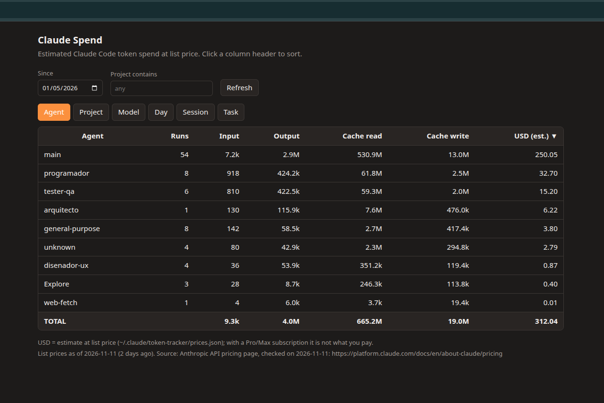

# claude-spend

Visualize Claude Code token usage in simple tables, either through an interactive terminal view or a local web page. In both interactive views, you can click on a column header to sort the data. Claude Code token usage is tracked and displayed, broken down by agent, project, model, day, session, and task.

> **Unofficial.** This is an independent project. It is not affiliated with, endorsed by or supported by Anthropic. "Claude" and "Claude Code" are trademarks of their owners.

Everything runs on your machine: it reads the transcripts Claude Code already keeps in `~/.claude/projects` and writes only to `~/.claude/claude-spend/`. Nothing is sent anywhere.



## Requirements
Python 3.9 or newer. No third-party packages. The interactive terminal view needs `curses`, which comes with Python on Linux and macOS but not on Windows.

## Platform support
claude-spend is developed and used day to day on **Linux**. The automated tests pass on Linux, macOS and Windows, with Python 3.9, 3.11 and 3.13, and CI also checks that the package builds and installs.

What the tests don't cover is real-world use on macOS and Windows: the Claude Code hooks, the interactive terminal view with the mouse, and the web page in your browser. I have only tried those by hand on Linux, so I'd really appreciate your help testing them on other systems. Let me know how it goes, whether that's "it works" or a bug report, by opening an issue or a pull request. Improvements of any kind are welcome.

## Files
- `claude_spend/tracker.py`: the log and the report (standard library only).
- `claude_spend/prices.json`: list prices per model, in USD per million tokens, with the date they were taken. A model can have `tiers`: a different price for the requests whose prompt is longer than a number of tokens (for example Haiku 5.5 above 100,000). It is decided request by request and a model can have several tiers.
- `claude_spend/web/`: the page that `--web` serves (`index.html`, `styles.css` and `main.js`).
- `pyproject.toml`: packaging, so it can be installed with `uv` or `pipx`.
- `claude-spend`: wrapper script for the manual install below.
- `hooks.settings.json`: the `Stop` and `SubagentStop` hooks for the manual install.
- `tests/` and `.github/workflows/tests.yml`: the test suite and the CI that runs it.

## Installation
There are two ways to install it. Either way, you then add the hooks to `~/.claude/settings.json` so that Claude Code records your spend as you work, and run `claude-spend --import` once to load the transcripts that are already on disk.

### With uv or pipx (Linux, macOS and Windows)
```bash
uv tool install git+https://github.com/emaza/claude-spend
# or: pipx install git+https://github.com/emaza/claude-spend
```
This puts the `claude-spend` command on your `PATH` and includes the price list. To update it later, run `uv tool upgrade claude-spend` (or `pipx upgrade claude-spend`).

Then add this to `~/.claude/settings.json`. Merge it with what you already have; do not replace the file:

```json
{
  "hooks": {
    "Stop": [
      { "hooks": [ { "type": "command", "command": "claude-spend hook", "async": true, "timeout": 30 } ] }
    ],
    "SubagentStop": [
      { "hooks": [ { "type": "command", "command": "claude-spend hook", "async": true, "timeout": 30 } ] }
    ]
  }
}
```

If Claude Code can't find the command, use its full path in `"command"`. You can get it with `which claude-spend` (`Get-Command claude-spend` in PowerShell).

### Manual install (Linux and macOS)
```bash
git clone https://github.com/emaza/claude-spend.git
cd claude-spend
mkdir -p ~/.claude/claude-spend ~/.local/bin
cp -r claude_spend/tracker.py claude_spend/prices.json claude_spend/web ~/.claude/claude-spend/
cp claude-spend ~/.local/bin/ && chmod +x ~/.local/bin/claude-spend
```
Then add the `hooks` block from `hooks.settings.json` to `~/.claude/settings.json`, merging it as above. Always copy `tracker.py`, `prices.json` and the `web` folder together.

### Windows
The tests pass on Windows, but I haven't tried the install steps, the hooks or the terminal view there by hand, and I'd expect the `uv` or `pipx` route to be the easier one. Please open an issue if something doesn't work.

If you prefer not to use `uv` or `pipx`, you can copy the files yourself. The `claude-spend` wrapper is a shell script, so on Windows run the tracker directly (use `py -3` instead of `python` if that's how you start Python):

```powershell
git clone https://github.com/emaza/claude-spend.git
cd claude-spend
New-Item -ItemType Directory -Force "$HOME\.claude\claude-spend" | Out-Null
Copy-Item -Recurse claude_spend\tracker.py, claude_spend\prices.json, claude_spend\web "$HOME\.claude\claude-spend\"
python "$HOME\.claude\claude-spend\tracker.py" --web
```

For the hooks, copy the `hooks` block from `hooks.settings.json`, but change the command so it works on your system, with the full path to the script. For example: `python "C:/Users/you/.claude/claude-spend/tracker.py" hook`.

The interactive terminal view (`--interactive`) needs `curses`. You can try `pip install windows-curses`. Without it, claude-spend prints the plain report instead, and `--web` works either way.

## Usage
```bash
claude-spend --import            # load the transcripts that are already on disk
claude-spend                     # tables by agent and by project
claude-spend --by all            # every table (the session table includes the start date, in local time, and the title; the title only appears in records made after it was added: `--import` fills it in for old sessions)
claude-spend --by day --since 2026-11-01 --project my-project
claude-spend --by session --sort usd:asc
claude-spend --interactive       # tables in the terminal; click a header to sort
claude-spend --web               # local web page; click a header to sort
```

| Option | Meaning |
|---|---|
| `report` (default), `hook`, `import` | what to do; `hook` is for the hooks, `import` is the same as `--import` and exits |
| `--by` | grouping: `agent`, `project`, `model`, `day`, `session`, `task` or `all`; can be repeated; default `agent` and `project` |
| `--since YYYY-MM-DD` | only records from that day on |
| `--project text` | only projects whose path contains the text |
| `--sort COLUMN[:asc\|desc]` | sort by `group` (or the grouping name), `date`, `title`, `runs`, `input`, `output`, `cache_read`, `cache_write` or `usd`. Without `:asc` or `:desc`, text sorts ascending and numbers and dates descending. Without `--sort`, `day` is sorted by date and everything else by USD, highest first |
| `--interactive` | terminal view (see below) |
| `--web` | web page on `127.0.0.1` |
| `--port N` | port for `--web` (default 8765) |
| `--no-open` | with `--web`, do not open the browser |

### Interactive terminal view
Click a column header to sort by it; click it again to reverse the order. A double click sorts once. Keyboard fallback for terminals without mouse support: `←` `→` choose a column, `Enter` or `s` sorts, `Tab` switches table, `↑` `↓` `PgUp` `PgDn` `Home` `End` scroll, `q` quits. `--sort` sets the initial order. If the output is not a terminal, it prints the plain report instead.

Mouse clicks depend on the terminal: most modern ones work, but some report double clicks differently, which is why a single click is enough.

### Web page
`claude-spend --web` serves the report on `http://127.0.0.1:8765` and opens it in your default browser. It only listens on your own machine and only reads the log; reloading the page (or pressing Refresh) recalculates it from the current data. The tables can be filtered by date and project. Click a row to filter every table by it: after clicking a project, for example, the other tabs show only that project's sessions, models, days and tasks. The page stays on the same tab. The filters add up; each one appears as a label above the tables, and clicking the label removes it. The page address keeps the filters, the tab and the sort order, so reloading keeps the view and the browser's Back button undoes the last filter. Press `Ctrl+C` to stop it.

## Plan usage
With a Pro or Max subscription, the report, the terminal view and the web page can also show how much of your current session (5-hour window) and your weekly limit you have used, and when each one resets. Claude Code passes these numbers to the status line command, so claude-spend saves them from there to `~/.claude/claude-spend/limits.json`. Nothing goes over the network.

If you already have a status line script, add this line right after it reads its input (`input=$(cat)`):

```bash
printf '%s' "$input" | claude-spend limits >/dev/null 2>&1 &
```

If you don't have one, this is enough in `~/.claude/settings.json`:

```json
{ "statusLine": { "type": "command", "command": "claude-spend limits" } }
```

The numbers are as fresh as the last time Claude Code refreshed the status line, and every view shows when that was ("Updated today at 1:05"). A window whose reset time has passed shows 0%.

## Data
The log is stored in `~/.claude/claude-spend/token-log.jsonl`. That file has your data and is not uploaded to the repository. It is append-only: each line is a snapshot of one agent in one session, and the report keeps the latest one. Keep this file if you want a long-term history, because Claude Code deletes old transcripts after a while and `--import` can only rebuild what is still on disk.

Running `--import` again is safe: it never counts a session twice. The total can still go up afterwards, because it picks up sessions the hooks did not record (for example, ones from before you installed them) and completes sessions whose last record was cut short.

The amounts are an estimate at list price. If you use a Pro or Max subscription, it is not what you pay. Prices change: check `prices.json` against [Anthropic's pricing page](https://platform.claude.com/docs/en/about-claude/pricing) and update it (and `_price_date`) when they do; the report warns when the prices are more than 90 days old.

claude-spend uses `~/.claude/claude-spend/prices.json` if that file exists, and otherwise the `prices.json` that comes with the package. To use your own prices, copy the bundled file to `~/.claude/claude-spend/prices.json` and edit that copy. It replaces the bundled list completely; the two are not merged.

### Updating
- With uv or pipx: `uv tool upgrade claude-spend` (or `pipx upgrade claude-spend`).
- With the manual install: run `git pull` in your clone and copy the files again, as in the install steps (`tracker.py`, `prices.json` and the `web` folder). If you have your own `prices.json`, leave out `prices.json` so your copy is kept.

Check the version with `claude-spend --version`. Your data stays where it is.

### Upgrading from 0.1.x
Before 0.2.0 the data folder was `~/.claude/token-tracker`. Move it to the new name and update the paths in your hooks (and in `~/.local/bin/claude-spend` if you used the manual install):
```bash
mv ~/.claude/token-tracker ~/.claude/claude-spend
```

### Uninstalling
1. Remove the program: `uv tool uninstall claude-spend` (or `pipx uninstall claude-spend`). With the manual install, delete `~/.local/bin/claude-spend`, `~/.claude/claude-spend/tracker.py` and `~/.claude/claude-spend/web`.
2. Remove the two claude-spend entries (`Stop` and `SubagentStop`) from the `hooks` block in `~/.claude/settings.json`, leaving any other hooks you have.
3. Your data stays in `~/.claude/claude-spend` (the log and your `prices.json`, if you made one). If you install it again later, it picks up the same log. Delete that folder only if you don't want to keep the history.

## Tests
```bash
python3 -m unittest discover -s tests
```
The tests use a temporary home directory (they set both `HOME` and `USERPROFILE`, and stop if that doesn't take effect), so they never touch your real `~/.claude`.

## Contributing
Bug reports, ideas and pull requests are all welcome. Reports from macOS and Windows are especially useful, since I have only used it by hand on Linux. If you send a pull request, please run the tests first.

## License
[MIT](LICENSE)
