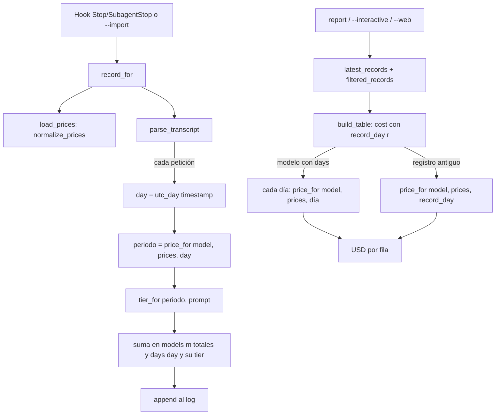

# Precios con vigencia temporal

> **Decisiones finales (CTO):** un uso anterior al primer `from` se cobra con el periodo **más antiguo** (no sin precio / 0 USD); donde este documento diga lo contrario, queda superado. El aviso se mantiene como "Models without a price". El test 15 (aviso de prices.json antiguo), "Spend by day" y `--since` quedan fuera de alcance.

Estado: propuesta · Versión objetivo: 0.5.0 · Afecta a: `claude_spend/tracker.py`, `claude_spend/prices.json`, `tests/test_tracker.py`, `README.md`

## 1. Resumen

Hoy cada modelo tiene un único precio en `prices.json` y el informe (`build_table` → `cost`) recalcula **todo** el histórico con él. Si un precio cambia, el coste pasado cambia también.

Qué se construye:

1. **`prices.json` admite una lista de periodos por modelo**, cada uno con su fecha de inicio `"from"` (`YYYY-MM-DD`, en UTC, inclusiva). Cada periodo dura hasta el `"from"` del siguiente y el último queda abierto. Una entrada plana, como las de ahora, es un único periodo vigente siempre, así que los archivos actuales siguen valiendo sin tocarlos. Los `"tiers"` van dentro de cada periodo.
2. **Los registros guardan el uso de cada modelo repartido por día UTC** (`models[m]["days"][día]`), calculado desde el `timestamp` de cada petición del transcript. Se reparte por día y no por periodo porque los periodos pueden cambiar después de grabar el registro y los días no.
3. **El informe cobra cada día con el periodo vigente en ese día**. Los registros antiguos, que no tienen `days`, se cobran con el precio vigente en la fecha del propio registro (`end` y, si falta, `ts`).

Por qué así: el informe sigue recalculando desde tokens, no desde un coste congelado. Así, si alguien corrige o completa `prices.json` tarde, el histórico se corrige solo, y añadir un precio nuevo con su `"from"` ya no reescribe el pasado. El cambio se limita a unas pocas funciones de `tracker.py`, sin dependencias nuevas ni un archivo de histórico aparte.

## 2. Componentes y responsabilidades

No se crean archivos nuevos de código. Cambios por archivo:

```
claude_spend/
  tracker.py        # funciones nuevas: utc_day, normalize_prices, period_for, record_day
                    # funciones que cambian: load_prices, price_for, parse_transcript, cost,
                    #   build_table, report_notes, prices_note (record_for, cmd_import y la web no cambian)
  prices.json       # nuevo "_periods_note"; los precios actuales siguen planos (no se inventa historial)
  web/              # sin cambios: la web solo muestra tablas y notas, que ya vienen calculadas
tests/
  test_tracker.py   # clase nueva PricePeriodTests y ajustes en CostTests
README.md           # sección "Price changes" (formato, UTC, --import)
docs/arquitectura/precios-con-vigencia.md   # este documento
```

| Función | Responsabilidad (nueva o cambiada) |
|---|---|
| `utc_day(ts)` **nueva** | Timestamp ISO (`Z`, con desfase o sin zona, que se toma como UTC) → `"YYYY-MM-DD"` en UTC, o `None` si no se puede leer. |
| `normalize_prices(raw)` **nueva** | JSON crudo → `({modelo: [periodos ordenados]}, [problemas])`. Valida. Nunca lanza excepciones. |
| `load_prices()` | Igual que ahora, pero devuelve la forma normalizada (siempre listas). |
| `period_for(periods, day)` **nueva** | El periodo vigente en `day`, o `None` si `day` es anterior al primer `"from"`. |
| `price_for(model, prices, day=None)` | Mismo emparejamiento por prefijo que ahora y, después, `period_for`. `day=None` = hoy (UTC). |
| `tier_for(p, prompt)` | Sin cambios: recibe un periodo, que tiene la misma forma que el precio plano de antes. |
| `parse_transcript(...)` | Reparte cada petición en `days[utc_day(ts)]` y decide el tramo con el periodo de ese día. |
| `record_day(r)` **nueva** | Fecha de reserva de un registro: `utc_day(r["end"] or r["ts"])`. |
| `cost(models, prices, day=None)` | Si el modelo tiene `days`, cobra cada día con su periodo. Si no (registro antiguo), usa `day`. |
| `build_table` / `report_notes` | Pasan `record_day(r)` a `cost`. `report_notes` saca los modelos sin precio de lo que devuelve `cost` y añade los problemas de `prices.json`. |
| `prices_note()` | Sin cambios de significado: `_price_date` sigue siendo "fecha en que se revisaron los precios". |

## 3. Modelo de datos y contratos

### 3.1 `prices.json`

```jsonc
{
  "_price_date": "2026-12-01",
  "_source": "...",
  // 1) Entrada plana (formato actual): un periodo vigente siempre.
  "claude-haiku-4-5": {"input": 1.0, "output": 5.0, "cache_read": 0.10, "cache_write_5m": 1.25, "cache_write_1h": 2.0},

  // 2) Lista de periodos. El primero puede no llevar "from" (= desde siempre).
  "claude-opus-5-5": [
    {"input": 5.0, "output": 25.0, "cache_read": 0.25, "cache_write_5m": 6.25, "cache_write_1h": 10.0},
    {"from": "2026-12-01", "input": 4.0, "output": 20.0, "cache_read": 0.20, "cache_write_5m": 5.0, "cache_write_1h": 8.0}
  ],

  // 3) Los tiers van dentro de cada periodo y pueden cambiar de un periodo a otro.
  "claude-haiku-5-5": [
    {"from": "2026-06-01", "input": 0.10, "output": 0.50, "cache_read": 0.01, "cache_write_5m": 0.125, "cache_write_1h": 0.20,
     "tiers": [{"prompt_over": 100000, "input": 0.50, "output": 2.50, "cache_read": 0.05, "cache_write_5m": 0.625, "cache_write_1h": 1.0}]}
  ]
}
```

Reglas:

- **Un objeto equivale a una lista con un solo elemento.** Un objeto sin `"from"` está vigente siempre. Si lleva `"from"`, empieza ese día.
- `"from"`: fecha `YYYY-MM-DD` en **UTC** e **inclusiva**. El periodo *i* cubre `[from_i, from_{i+1})` y el último no tiene fin.
- **Solo el primer periodo** (una vez ordenados) puede omitir `"from"`.
- Como solo hay fecha de inicio, **no puede haber huecos ni solapes entre periodos**. El único hueco posible es antes del primer `"from"`: un uso anterior a esa fecha **no tiene precio**. Se cuenta como 0 USD y se avisa, igual que un modelo sin precio. Se descarta usar el precio más antiguo porque eso inventaría un precio.
- No hay `"to"` ni hora. Ver la sección 5.

Forma normalizada (lo que devuelve `load_prices()`):

```python
Prices = dict[str, list[Period]]   # ordenada por "from" ascendente; "from" None solo en [0]
Period = dict  # {"from": str | None, "input": float, ..., "tiers": [...]}, misma forma que el precio plano de hoy
```

Validación en `normalize_prices`. Nunca lanza excepciones, para que el hook no rompa la sesión:

| Caso | Qué hace |
|---|---|
| Lista desordenada | Se ordena por `"from"`. No es un error. |
| `"from"` que no es `YYYY-MM-DD` válido (`dt.date.fromisoformat`) | Se **descarta el modelo** y se anota `"prices.json: claude-x ignored: invalid from '2026-13-01'"`. |
| Dos periodos con el mismo `"from"`, o más de uno sin `"from"` | Se descarta el modelo y se anota "duplicate from". |
| Lista vacía, o un elemento que no es objeto | Se descarta el modelo y se anota el problema. |
| Claves que empiezan por `_` | Se ignoran, igual que ahora. |

Al descartar un modelo, este pasa a "sin precio", y eso ya sale como aviso en el informe. Se descarta el modelo y no el archivo entero para que un error en una línea no deje a 0 todos los demás.

### 3.2 Registro del log (`token-log.jsonl`)

Se añade `days` dentro de cada modelo. Los totales se mantienen porque los usan las columnas de tokens y `latest_records` (que cuenta `requests`). Los `tiers` pasan a estar dentro de cada día, que es donde se cobran.

```jsonc
"models": {
  "claude-opus-5-5": {
    "input": 1200, "output": 300, "cache_read": 0, "cache_write_5m": 0, "cache_write_1h": 0, "requests": 3,
    "days": {
      "2026-11-30": {"input": 1000, "output": 200, "cache_read": 0, "cache_write_5m": 0, "cache_write_1h": 0, "requests": 2},
      "2026-12-01": {"input": 200,  "output": 100, "cache_read": 0, "cache_write_5m": 0, "cache_write_1h": 0, "requests": 1,
                     "tiers": {"100000": {...}}}
    }
  }
}
```

- Clave del día: `utc_day(timestamp de la petición)`. Si una petición no trae `timestamp`, se usa el último `timestamp` visto en el transcript y, si no hay ninguno, el día UTC actual.
- Los registros nuevos **no** llevan `tiers` en el nivel del modelo. Los registros antiguos (sin `days`) sí, y `cost` los sigue leyendo como ahora.
- `cost_usd` se sigue guardando como dato informativo. El informe no lo usa: recalcula siempre.

### 3.3 Firmas

```python
def utc_day(ts: str | None) -> str | None
def normalize_prices(raw: dict) -> tuple[dict[str, list[dict]], list[str]]
def load_prices() -> dict[str, list[dict]]
def period_for(periods: list[dict], day: str | None) -> dict | None      # day None = hoy UTC
def price_for(model: str, prices: dict, day: str | None = None) -> dict | None
def tier_for(p: dict | None, prompt: int) -> dict | None                 # sin cambios
def record_day(r: dict) -> str | None
def cost(models: dict, prices: dict, day: str | None = None) -> tuple[float, list[str]]
def parse_transcript(path, skip_sidechain=False, prices=None)             # misma firma y la misma tupla de vuelta
def build_table(by, records, prices)                                      # misma firma
def report_notes(records, prices) -> list[str]                            # misma firma
```

`cost` mantiene la regla de ahora: un tramo que ya no existe en el periodo se cobra a precio base. `unknown` contiene el nombre del modelo, sin repetir, si **algún** día suyo no tiene precio.

API HTTP: sin cambios. `/api/report` ya devuelve `notes` y las tablas calculadas.

## 4. Flujo principal



Paso a paso:

1. `record_for` carga los precios normalizados.
2. `parse_transcript` guarda `(modelo, usage, timestamp)` por id de mensaje. Si un mensaje se repite, cuenta la última entrada, igual que ahora.
3. Para cada petición calcula `day`, elige el periodo vigente con `price_for(model, prices, day)` y el tramo con `tier_for(periodo, prompt)`. Después suma los tokens en los totales del modelo y en `days[day]`, y también en `days[day]["tiers"][umbral]` si la petición cae en un tramo.
4. El informe llama a `cost({model: t}, prices, record_day(r))`. Con `days`, suma el coste de cada día con su periodo. Sin `days`, cobra los totales con el periodo vigente en `record_day(r)`.
5. `report_notes` junta en una lista sin repetidos el `unknown` de cada registro y le añade los problemas de `normalize_prices`.

## 5. Decisiones y riesgos

### Decisiones y alternativas descartadas

| Decisión | Alternativa descartada | Motivo |
|---|---|---|
| Recalcular siempre desde tokens con precio por fecha | Congelar `cost_usd` al grabar | Si `prices.json` se actualiza tarde (el precio cambia el día 1 y el archivo se edita el 20), los registros de esos días quedarían mal para siempre. Recalculando, basta con poner bien el `"from"`. |
| Repartir por **día UTC** dentro del registro | Repartir por periodo de precio | Los periodos pueden cambiar después de grabar. Los días no, así que el registro no depende de `prices.json`. |
| Repartir por día | Guardar cada petición | El log crecería con cada petición. Por día son unas pocas entradas por sesión. |
| Solo `"from"` | `"from"` + `"to"` | Con `"to"` aparecen huecos y solapes que habría que validar. Con solo `"from"` son imposibles por construcción. |
| Fecha sin hora, en UTC | `datetime` con zona, o la zona local | Los cambios de precio se anuncian por día. Los timestamps del transcript están en UTC (`Z`). Usar UTC da el mismo resultado en cualquier máquina. El agrupado "day" ya trocea `end` en UTC. |
| Lista de periodos en el mismo `prices.json` | Un `price-history.json` aparte | Habría dos fuentes de verdad y otra regla de prioridad entre el archivo del usuario y el empaquetado. |
| Uso anterior al primer `"from"` = sin precio | Aplicar el periodo más antiguo | Sería inventar un precio. En la práctica no ocurre, porque nadie usa un modelo antes de que salga. |

### Registros ya guardados

- **Sin `days`** (todos los de ≤ 0.4.1): se cobran enteros con el precio vigente en `record_day(r)`, que es el día UTC de `end`. Es una aproximación si la sesión cruzó un cambio de precio.
- **Cómo se arreglan**: `claude-spend --import` vuelve a leer los transcripts que siguen en disco y añade registros con `days`. `latest_records` se queda con el de más `requests` y, si empatan, con el último (`>=`), así que el registro importado sustituye al antiguo sin duplicar nada. Los transcripts que Claude Code ya borró se quedan con la aproximación. Hay que documentarlo en el README.
- **Sin migración automática del log**: el log es de solo añadir y no se reescribe.

### `prices.json` del usuario antiguo

- Sigue funcionando tal cual: cada entrada plana es un periodo vigente siempre. El resultado es exactamente el de ahora.
- **Nunca se escribe en él** (regla actual: el archivo del usuario manda y no se fusiona con el empaquetado).
- Para registrar un cambio de precio, el usuario convierte esa entrada en una lista: deja el precio viejo sin `"from"` y añade el nuevo con su `"from"`. El README lo explicará con un ejemplo.
- Aviso opcional (tarea 6): si se usa el archivo del usuario y su `_price_date` es anterior al del empaquetado, `report_notes` lo indica ("the bundled prices are newer (YYYY-MM-DD); review your prices.json").

### Riesgos y qué vigilar

- **Tramos fijados al grabar**: el tramo de cada petición se decide en `parse_transcript` con los umbrales del periodo de ese día. Si después se añade o cambia un tier de un periodo pasado, hay que volver a ejecutar `--import`, como ahora, y solo funciona si el transcript sigue en disco.
- **La convención UTC** puede no coincidir con la hora exacta del cambio real: unas horas alrededor de medianoche UTC del día del cambio pueden cobrarse con el precio del otro periodo. Es asumible para una estimación.
- **Tamaño del log**: crece un poco (`days` en cada foto). Las sesiones de varios días son pocas.
- **"Spend by day" y `--since` siguen usando `end`**: un registro que cruza la medianoche se asigna entero a su último día en esa tabla, aunque su USD ya se calcule por días. Es el comportamiento de hoy y queda fuera de alcance.
- **Rendimiento**: `cost` recorre los días de cada modelo y la web construye 6 tablas. El coste es lineal y pequeño, pero hay que vigilarlo si el log llega a decenas de miles de registros.
- **El hook nunca falla**: `normalize_prices` y `utc_day` no pueden lanzar excepciones ante datos malos.
- **Python 3.9** (está en el CI): `datetime.fromisoformat` no acepta `Z`, así que hay que cambiarla por `+00:00` como ya hace `local_dt`. Acepta milisegundos con 3 dígitos.

## 6. Plan de implementación

Las tareas van en orden. Cada una termina con `python -m unittest discover -s tests -v` en verde. Durante el desarrollo se prueba solo desde el repo, sin reinstalar la herramienta del usuario.

**T1. Normalizar y elegir el periodo.** Crear `utc_day`, `normalize_prices` y `period_for`. Hacer que `load_prices` devuelva la forma normalizada y añadir `day` a `price_for`.
*Hecho cuando*: pasan los tests 1–4. En `test_price_for_matches_variants_but_not_other_versions`, `assertIs(..., p["claude-opus-5-5"])` pasa a comparar con `p["claude-opus-5-5"][0]`. El `prices.json` empaquetado carga los 22 modelos sin problemas.

**T2. Reparto por día en `parse_transcript`.** Guardar el timestamp de cada petición, rellenar `days` y decidir el tramo con el periodo de ese día. Quitar `tiers` del nivel del modelo en los registros nuevos.
*Hecho cuando*: pasan los tests 5–7. La tupla que devuelve no cambia.

**T3. `cost` por día, con `record_day` como reserva.** Sacar a una función interna el cálculo de un bucket (base y tramos) y aplicarlo a cada día o a los totales antiguos.
*Hecho cuando*: pasan los tests 8–9 y el test actual `test_tier_price_applies_per_request` (0.0781) pasa sin cambiar el número.

**T4. Informe.** Hacer que `build_table` y `report_notes` usen `record_day(r)`. Que `report_notes` saque el aviso de "sin precio" de `cost` (texto: "Models without a price for the date they were used (counted as 0 USD): …") y añada los problemas de `normalize_prices`.
*Hecho cuando*: pasan los tests 10–12 y los de `TableTests`, `CliTests` y `WebTests` siguen en verde.

**T5. Hook e import, de punta a punta.** No cambia código, salvo que aparezca algo.
*Hecho cuando*: pasan los tests 13–14.

**T6. Documentación y versión.** Añadir `"_periods_note"` al `prices.json` empaquetado con la explicación del formato y actualizar `"_tiers_note"` ("tiers go inside each period"). Añadir al README la sección "Price changes" (formato, UTC inclusivo, uso anterior al primer `from` = sin precio, `--import` para repartir por día los registros antiguos). Subir `__version__` a `0.5.0`. Opcional: el aviso de `prices.json` del usuario más antiguo que el empaquetado (test 15).
*Hecho cuando*: el README describe el formato con un ejemplo, el CI (3 sistemas × 3 Pythons y el job del paquete) está en verde y `claude-spend --version` muestra 0.5.0.

### Tests concretos (clase nueva `PricePeriodTests` en `tests/test_tracker.py`)

Cada test escribe su propio `prices.json` en `self.base`. Precio de ejemplo: modelo `m` con input 1.0 hasta el 2026-11-30 y 2.0 desde el `"from": "2026-12-01"`.

1. `normalize_prices`: una entrada plana da `[{"from": None, ...}]`. Una lista desordenada sale ordenada. Un `"from"` duplicado, un `"from": "2026-13-01"`, dos periodos sin `"from"` o una lista vacía hacen que se descarte el modelo y se anote un problema con su nombre. Las claves `_x` se ignoran. Los datos raros (`None`, números, cadenas) no lanzan excepciones.
2. `period_for`: el 2026-11-30 elige el periodo 1 y el 2026-12-01 el periodo 2 (inclusivo). Un día de 2030 elige el último. Con un primer periodo `"from": "2026-06-01"`, el 2026-05-31 da `None`. Con un primer periodo sin `"from"`, 1990-01-01 elige ese.
3. `price_for` con variante y fecha: `price_for("m-20261101", prices, "2026-12-05")["input"] == 2.0`.
4. `utc_day`: `"2026-11-30T23:30:00.000Z"` da `"2026-11-30"`, `"2026-11-30T20:00:00-05:00"` da `"2026-12-01"`, `"basura"` y `None` dan `None`.
5. `parse_transcript` con dos peticiones (23:30Z del 30 y 00:30Z del 1): `days` tiene dos claves con sus tokens, y la suma de los `days` es igual a los totales.
6. Una petición sin `timestamp` va al día del último timestamp visto.
7. Tramo por periodo: el tier solo existe en el periodo 2. Una petición de 150k el día 30 no lleva `tiers` y la del día 1 sí.
8. `cost` de un modelo con `days` en ambos periodos: 1M input el día 30 y 1M el día 1 suman exactamente 3.0 USD.
9. `cost` de un registro antiguo sin `days`, con `day="2026-11-30"` da 1.0 y con `day="2026-12-01"` da 2.0.
10. **Requisito del cliente**: con `build_table("model", ...)` sobre registros de noviembre, si se añade a `prices.json` un periodo nuevo con `"from"` de diciembre y se recalcula, el USD de noviembre no cambia, y el de un registro de diciembre sí.
11. `report_notes`: un uso anterior al primer `"from"` sale en el aviso de "sin precio", y un modelo descartado por validación sale como problema de `prices.json`.
12. Compatibilidad: con el `prices.json` empaquetado (todo plano), un registro antiguo sin `days` y uno nuevo con `days` del mismo uso dan el mismo USD.
13. Hook (subprocess, como `HookTests`): con un `prices.json` de periodos y un transcript que cruza el cambio, el registro lleva `days` y el `cost_usd` es correcto.
14. Import sustituye a un registro antiguo: un log con un registro sin `days` para (s1, main) y un import del mismo transcript (mismas `requests`) hacen que `latest_records()` devuelva el registro con `days`.
15. (Opcional, T6) Si el `_price_date` del usuario es anterior al del empaquetado, aparece la nota "bundled prices are newer".

## Preguntas para el CTO

1. **Convención de zona horaria**: propongo que `"from"` sea un día UTC. ¿El cliente necesita otra zona, por ejemplo la de su facturación, o la hora exacta del cambio? Si es así, `"from"` pasaría a ser un datetime ISO y los registros tendrían que repartirse por hora, lo que complica el diseño.
2. **Uso anterior al primer periodo**: propongo tratarlo como "sin precio" (0 USD y aviso). ¿El cliente prefiere que se aplique el precio más antiguo?
3. **Historial real en el `prices.json` empaquetado**: este diseño no inventa precios pasados y deja todas las entradas planas. ¿Alguien debe reconstruir los cambios de precio históricos reales, con sus fechas, a partir de fuentes de Anthropic?
4. **Tabla "Spend by day" y `--since`**: ¿hay que repartir también esa tabla por los `days` del registro? Es un cambio pequeño, pero cambia lo que muestra la tabla y queda fuera de este alcance.
5. **Aviso de `prices.json` del usuario desactualizado** (T6 opcional): ¿lo incluimos en esta versión?
